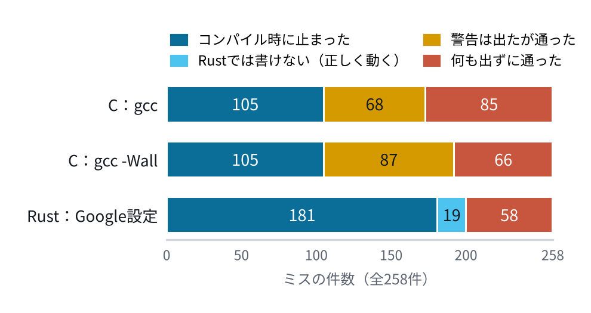

# 自分の C 言語のミスは、Rust ならコンパイル時に止まるか

無線研究部の研究発表「C言語のミスはRustで防げるか」で行った実験のプログラムとデータです。



## 結果（ミス 258 件）

| | コンパイル時に止まった | 警告だけで通った | 何も出ずに通った |
|---|---:|---:|---:|
| C：gcc（オプションなし） | 105 | 68 | 85 |
| C：gcc -Wall | 105 | 87 | 66 |
| Rust：rustc（標準） | 173 | 8 | 77 |
| Rust：Google の設定 | 181 | 0 | 77 |

Rust（Google の設定）で「何も出ずに通った」77 件の内訳：

- 19 件は、Rust の書き方ではそもそも書けない（printf の書式と型の食い違いなど）。プログラムは正しく動く
- 5 件は、配列の範囲外や 0 での割り算で、実行時にその場で止まる
- 53 件は、ループの範囲や計算式の誤りで、Rust でも見つからない

**gcc（オプションなし）でコンパイルを通り抜けたミスは 153 件。Rust（Google の設定）では 58 件に減った（62% 減）。**

## やり方

1. VS Code の編集履歴（978 版）、授業のフォルダ、AI との会話から、自分で書いて後から直したミスを集めた（310 件。同じ行から出た重複をまとめると 258 件）
2. 258 件を 41 パターンに分けた
3. パターンごとに「正しい版（after）」と「ミスを 1 つだけ入れた版（before）」を C と Rust で書いた
4. 4 通りの設定でコンパイルした。正しい版は 4 通りすべてで警告 0 になることを確認した（＝出たエラーは入れたミスが原因）

### Google の設定

- unsafe を使わない（全プログラムに `#![forbid(unsafe_code)]`）
- Android が Google 製の Rust コードに既定で付けるフラグ：`-A deprecated -D missing-docs -D warnings`
- Clippy の既定の検査に加え、`-A clippy::type-complexity -A clippy::unnecessary-wraps -A clippy::unusual-byte-groupings`

出典：[Android build/soong rust/config/lints.go](https://android.googlesource.com/platform/build/soong/+/45901edb9a6ba7b42136a3ead126f94f76363eb7/rust/config/lints.go)、[Rust in Android: move fast and fix things（Google, 2025）](https://blog.google/security/rust-in-android-move-fast-fix-things/)

### C → Rust の書き換えルール（固定）

| C | Rust |
|---|---|
| `int` / `double` | `i32` / `f64`（暗黙の型変換はしない） |
| `&x`（ポインタ渡し） | `&mut x` |
| 配列を渡す | スライス `&[T]` |
| `scanf("%d", &x)` | `read_into::<i32>(&mut x)`（`%lf` なら `f64`） |
| `printf("%d", x)` | `println!("{x}")` |
| `for (初期化; 条件; 更新) { 本体 }` | `初期化; while 条件 { 本体; 更新; }` |
| `x = x + y` | `x += y` |
| `#include` | `use` |
| カンマ演算子 / 式の中の `i++` | タプル式 / `{ let t = i; i += 1; t }` |

## フォルダ

- `programs/Pxx/` … パターンごとの `before.c` `after.c` `before.rs` `after.rs`
- `scripts/patterns.py` … 41 パターンの定義
- `scripts/run.py` … 4 通りでコンパイルして `results/pattern_results.json` を作る
- `scripts/tally.py` … ミス 258 件をパターンに割り当てて数え、`results/mistakes.json` を作る
- `data/mistakes.csv` … 集めたミスの一覧（337 件、AI が関わった可能性のある分を含む）と、1 件ずつの実験結果。GitHub 上で表として見られる
- `data/self_rows.json` … 自分が書いた分 310 件（集計スクリプトの入力）

## 動かし方

gcc、rustc、clippy-driver が必要です。

```sh
python3 scripts/run.py     # コンパイル（30秒くらい）
python3 scripts/tally.py   # 集計
```

## 環境

gcc 13.3（Ubuntu 24.04）、rustc 1.97.0。C89 のパターン（P07）だけ `-std=gnu89` で、学校の古い gcc に合わせた。

## 注意

- 1 件ずつ実物のファイルをコンパイルしたのではなく、パターンごとの代表プログラムで測っている
- 「自分が書いたか／AI が関わったか」は、大きな貼り付けがあったかどうかで推定した。AI が関わった可能性がある分は除いてある
- ロジックのミス（ループの範囲など）は、編集履歴の小さな修正から自分で判断して選んだ
